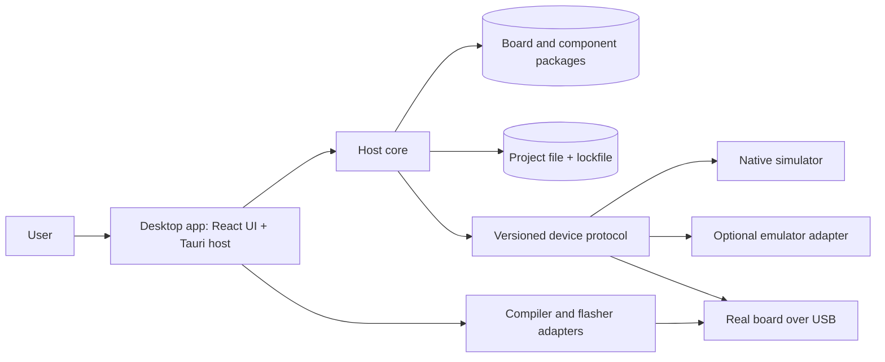

# Architecture — Micro Controller Playground

| Field | Value |
| --- | --- |
| Scope | Whole product, design baseline |
| Last updated | 2026-10-28 |

This document describes the intended structure. Nothing here is implemented yet; implementation evidence belongs in [`evidence.md`](./evidence.md).

## Overview

The product is a desktop workbench with a pure Rust core. A project selects a board, component instances, logical nets, and a firmware entry point. The host resolves the project, validates the packages, and starts a device backend. The backend runs the firmware against a virtual board, an emulator, or a real board. The UI only consumes typed session state and trace events.

The most important architectural idea is the **device boundary**: simulation and hardware are interchangeable backends behind one versioned protocol. The second is the **package boundary**: boards and components are leaf packages that implement narrow APIs and never leak into the core or UI.

## System Context



## Components

| Component | Responsibility | Owns / Uses |
| --- | --- | --- |
| **Desktop UI** | Project editing, canvas, inspector, run controls, serial and trace views. | View state only; no simulator or hardware access. |
| **Host core** (`apps/desktop` native side) | Project/catalog service, session lifecycle, typed IPC, adapter orchestration. | Project, catalog, active session, toolchain processes. |
| **`playground-core`** | IDs, project schema, logical netlist, capabilities, time and trace types. | Pure domain types; no OS or UI dependencies. |
| **`playground-component-api`** | Component trait, pin/bus types, manifest types. | Component-facing contracts only. |
| **`playground-board-api`** | Board trait, pin capabilities, bus definitions, board manifest types. | Board-facing contracts only. |
| **`playground-sim`** | Deterministic scheduler, net resolution, buses, component registry. | Simulation state and trace ring buffer. |
| **`playground-protocol`** | Wire codec, handshake, session identity, capabilities, compatibility. | `no_std` protocol types and framing. |
| **`playground-firmware-core`** | `no_std` firmware runtime and HAL ports; host-sim adapters. | Firmware behavior; no host or UI dependencies. |
| **`playground-catalog`** | Manifest parsing, validation, registry generation, lockfile resolution. | Package metadata and validation errors. |
| **Native simulator backend** | Runs the firmware core against virtual pins and buses. | Virtual board, component models, simulation clock. |
| **Emulator backend** (later) | Runs unmodified firmware in Renode/QEMU and bridges pins, buses, and serial. | External emulator process and bridge state. |
| **Physical backend** | Runs firmware on a real board over USB and bridges the same protocol. | Serial connection, board identity, flash lifecycle. |
| **Compiler/flasher adapters** | Detect tools, build firmware, flash a verified image, stream output safely. | Allowlisted commands and bounded logs. |

## Main Flows

### Open a project

1. The UI asks the host to open a project directory.
2. The host reads the project file and lockfile.
3. The catalog resolves board and component packages by ID and version.
4. The validator checks pins, capabilities, buses, parameters, and firmware compatibility.
5. The host builds a resolved project and returns typed DTOs to the UI.

### Run in the native simulator

1. The host creates a native backend from the resolved project.
2. The firmware core boots against virtual pins and buses.
3. The scheduler advances in integer time and emits trace events.
4. Component models react to pin and bus changes.
5. The host batches state and trace deltas to the UI; the UI renders pin state, serial, and the logic analyzer.

### Run on hardware

1. The host builds the firmware image through an allowlisted toolchain adapter.
2. The image identity is checked against the selected board.
3. The host flashes the image and waits for a compatible handshake.
4. The physical backend exposes the same session protocol as the simulator.
5. The UI shows the same panels; the backend identity is visible, but the workflow is unchanged.

### Add a board or component package

1. The author adds a package directory with a manifest, optional model, optional driver, and UI assets.
2. The catalog validates the manifest and code against the API version.
3. The package appears in the palette; the core and UI do not change.
4. Contract tests prove the model/driver behavior.

## Interfaces

| From | To | Interface | Purpose |
| --- | --- | --- | --- |
| React UI | Host core | Typed Tauri commands and events | Project editing, run control, status; no raw paths, serial bytes, or shell. |
| Host core | Device backend | `playground-protocol` session | Handshake, capabilities, pin/bus events, serial, reset, heartbeat. |
| Host core | Catalog | Manifest files + lockfile | Resolve and validate board/component packages. |
| Host core | Compiler/flasher | Allowlisted subprocess adapters | Build and flash with bounded output and typed failures. |
| Component driver | Firmware | `embedded-hal` 1.0 traits | Reusable firmware drivers across boards and the simulator. |
| Component model | Simulator | Component API | Device-side behavior at pins and buses. |
| Board package | Simulator / firmware | Board API + manifest | Pin capabilities, bus mapping, board model, firmware recipe. |

## Data

| Data | Owner | Storage | Notes |
| --- | --- | --- | --- |
| Project | User | Project file on disk | Board ref, parts, nets, firmware ref, simulation settings. |
| Lockfile | Host core | Project directory | Pins resolved package versions and content hashes. |
| Board/component packages | Package author | Catalog directories | Manifest + model/driver/UI assets; versioned. |
| Simulation trace | Simulator | Memory + optional file | Timestamped pin, bus, serial, and lifecycle events. |
| Firmware image | Build adapter | Build directory | Identity-checked before flashing; never silently chosen. |
| Evidence | Maintainer | `docs/evidence.md` | Pass/fail results with commit, platform, command, and artifact. |

## Package Dependency Direction

Arrows point inward; outer layers depend on inner ones, never the reverse.

```text
apps/desktop ──► playground-catalog ──► playground-core
      │                    │
      ├──────────────► playground-sim ──► component-api / board-api
      ├──────────────► playground-protocol
      └──────────────► playground-firmware-core

components/* ──► component-api
boards/*     ──► board-api
firmware/*   ──► firmware-core + board-api
```

Rules:

- `playground-core` must not depend on Tauri, serial, filesystem, UI, simulation, or a specific board/component.
- Components and boards must not import core internals or each other.
- The UI must not import simulator internals; it consumes DTOs and events.
- Firmware must not depend on host crates or `std`.
- A package may depend on a vendor crate for its own behavior, but not on another package's internals.

## Constraints

- **Offline-first** — projects open and run without an account or network.
- **Deterministic simulation** — integer time, seeded randomness, stable event ordering. No wall-clock time in the simulation core.
- **No arbitrary native plugins** — built-in packages are compiled in; user behavior is sandboxed WASM later.
- **Bounded logs and output** — compiler/flasher output is captured with limits and never exposed as raw shell.
- **Separate version axes** — app, project schema, package schema, protocol, component API, and firmware are versioned independently.
- **Evidence discipline** — host-sim, emulator, and physical results are distinct classes of proof.

## Key Decisions

- [ADR-0001](./adr/0001-device-backends-behind-one-protocol.md) — device backends behind one protocol.
- [ADR-0002](./adr/0002-runtime-package-catalog.md) — built-in and project-local package catalog.
- [ADR-0003](./adr/0003-logical-nets-and-board-binding.md) — logical nets and board pin binding.
- [ADR-0004](./adr/0004-component-model-driver-split.md) — component model/driver split and WASM plugins.
- [ADR-0005](./adr/0005-versioned-device-protocol.md) — one versioned device protocol.
- [ADR-0006](./adr/0006-deterministic-simulation-and-evidence.md) — deterministic simulation and evidence tiers.
